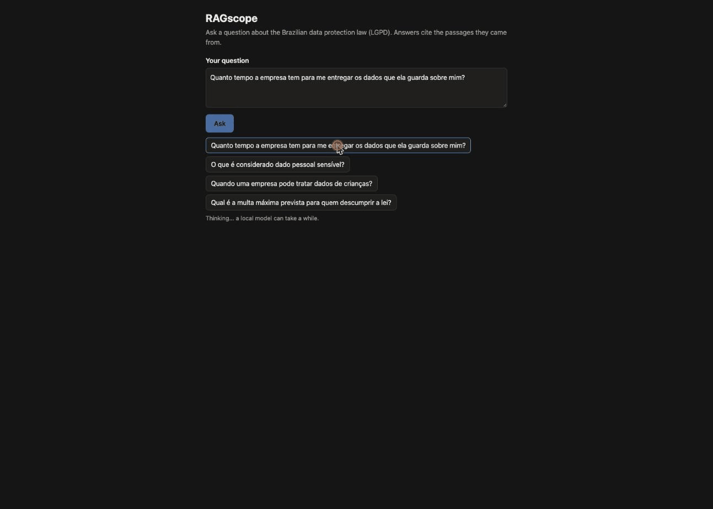
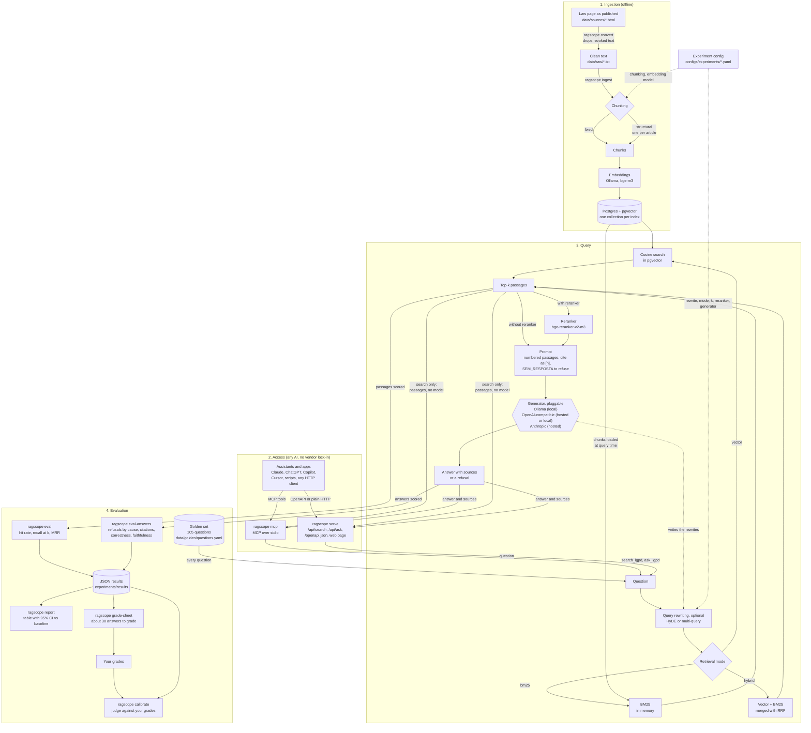

# RAGscope

[](https://github.com/piovani/RAGscope/actions/workflows/ci.yml)
[](go.mod)
[](LICENSE)
[](https://goreportcard.com/report/github.com/piovani/RAGscope)
[](https://github.com/piovani/RAGscope/commits/main)
[](https://github.com/piovani/RAGscope/issues)

> A Go laboratory that runs many RAG configurations over the same corpus and tells you, **with numbers**, which one is best on quality, cost and latency.

**Status:** working end to end on one corpus (the Brazilian data protection law, LGPD). Seven retrieval configurations are compared with confidence intervals, and a reranker, query rewriting (HyDE, multi-query), answer generation, a correctness and faithfulness judge, a web demo and open integrations (MCP, OpenAPI) are implemented. **It is not tied to any AI vendor:** the generator is local Ollama, any OpenAI-compatible server or Anthropic, and any assistant (Claude, ChatGPT, Copilot, Cursor, a script) can use it as a tool. See [Use it from any AI](#use-it-from-any-ai). The retrieval experiments, HyDE, multi-query and the full answer run over the golden set are **measured**. Two things are **not done on purpose**: the judge calibration, which needs a person's grades (the sheet is ready), and a run with a paid hosted model, which is blocked unless you pass `--allow-paid`. See the [roadmap](#roadmap).



---

## Why this project exists

Most RAG demos are "chat with a PDF": one fixed pipeline, no evidence that it works, no way to know whether a change made it better or worse.

RAGscope inverts that. **The product is the benchmark, not the chatbot.** The `ask` command is just a demo surface; the value is a reproducible experiment runner that answers questions like:

- Does structure-aware chunking beat fixed-size chunking on legal text?
- How much recall does hybrid search (vector + BM25) buy?
- Is a reranker worth its extra time?
- Can a small local model answer well, and does it know when to refuse?
- Does rewriting the question (HyDE, multi-query) help, and is a hosted model worth its cost?

## Corpus

The **LGPD** (Lei nº 13.709/2018), from the official Planalto portal. Public text, in Portuguese, organized in articles, paragraphs and items. The pipeline is domain-agnostic: another corpus needs a new source and a new golden set.

The page marks revoked wording with a strike, which a plain copy and paste loses. So the original page is kept in `data/sources/` and `ragscope convert` rebuilds the clean text from it. Details in [data/README.md](data/README.md).

## Architecture

The full explanation is in [docs/architecture.md](docs/architecture.md).



## Use it from any AI

RAGscope is not a chatbot for one assistant, and it needs no particular vendor. The same two operations, **search** (the passages, no model) and **ask** (an answer with citations), are exposed in open ways:

| Way in | Command | Works with |
|---|---|---|
| MCP over stdio | `ragscope mcp -c <config> --retrieval-only` | Claude, GitHub Copilot (VS Code), Cursor and other MCP clients |
| HTTP + OpenAPI 3.1 | `ragscope serve -c <config>` → `/api/search`, `/api/ask`, `/openapi.json` | ChatGPT custom GPT Actions, Copilot extensions, `curl`, any script |

With `search`, the assistant brings its own model and RAGscope brings checkable evidence. Setup for each client is in [docs/integrations.md](docs/integrations.md).

## Results

Retrieval, on the 95 questions that the law answers. Each experiment changes **one thing** from the baseline (fixed chunks of 512 words, vector search, top 5). Δ is the difference to the baseline with a 95% confidence interval; **\*** means the interval does not include zero.

| Experiment | What changes | Recall@1 | Δ Recall@1 | Recall@5 | MRR@5 |
|---|---|--:|--:|--:|--:|
| `hybrid-rerank-structural` | one chunk per article, vector + BM25, reranker | **0.695** | **+0.144 [+0.027, +0.258] \*** | 0.886 | **0.806** |
| `ablation-rerank` | reranker over 10 candidates | 0.677 | **+0.126 [+0.035, +0.219] \*** | 0.886 | 0.795 |
| `ablation-structural` | one chunk per article | 0.611 | +0.059 [−0.047, +0.168] | 0.881 | 0.746 |
| `ablation-hybrid` | vector + BM25 merged with RRF | 0.572 | +0.021 [−0.074, +0.112] | **0.895** | 0.738 |
| `baseline` | — | 0.551 | — | 0.870 | 0.712 |
| `ablation-hybrid-structural` | one chunk per article and vector + BM25 | 0.547 | −0.004 [−0.123, +0.115] | 0.812 | 0.665 |
| `ablation-hyde` | search also with a hypothetical answer | 0.504 | −0.047 [−0.142, +0.042] | 0.840 | 0.677 |
| `ablation-multiquery` | search with 3 rephrasings, merged | 0.499 | −0.053 [−0.116, +0.011] | 0.832 | 0.665 |
| `ablation-bm25` | BM25 only | 0.486 | −0.065 [−0.179, +0.047] | 0.818 | 0.644 |

Reproduce the tables with `ragscope report --k 1` and `ragscope report`.

### What the numbers say

- **The reranker is the only change that clearly helps**, and only at the top of the list: the relevant passage comes first much more often (recall@1 from 0.551 to 0.677 and 0.695). Its recall@5 is about the same as the baseline, because it reorders candidates instead of finding new ones. That matters for small models, which depend on the first passage.
- **Query rewriting did not help.** HyDE and multi-query are slightly below the baseline on recall (intervals include zero), and multi-query is significantly worse on MRR@5 (−0.046 [−0.093, −0.001]). Both cost a lot of time: p95 of about 33 s (HyDE) and 8 s (multi-query), against 51 ms. The rewriter is the same 3B model, which probably writes a hypothetical passage worse than the question itself. A stronger rewriting model was not tried.
- **Everything else is inside the noise.** With 95 questions, the intervals of structural chunking, hybrid search and BM25 all include zero.
- **An early conclusion did not survive.** With the first 30 questions, structural chunking looked like a big win (+0.200 recall@5). With 64 it was +0.039, and with 95 it was +0.011. The first questions were written close to the wording of the articles, which favours that kind of chunking. A small, hand-shaped test set can mislead.
- **Combining two things that help did not add up.** Structural chunks plus hybrid search without a reranker were *worse* than either alone. The reason is not known yet.

### Answers

Full golden set (95 answerable, 10 not), `ablation-structural` with `llama3.2:3b`, answers judged by the same small model. Run on an 8 GB laptop, 16.3 s per answer on average (p95 29.3 s).

| Measure | Result | Reading |
|---|--:|---|
| Correct refusal | 0.800 (8 of 10) | it refused 8 of the 10 questions the law does not answer. It answered 2 (income tax rate, countries with adequate protection) |
| False refusal | 0.242 (23 of 95) | refused an answerable question |
| · evidence missing | 0.084 (8) | the retriever did not bring the passage, so refusing was fair |
| · evidence present | 0.158 (15) | the passage was there and the model refused anyway: too timid |
| Answers that cite a passage | 0.405 | most answers do not cite `[n]`, although the prompt asks |
| Faithfulness | 0.838 (74 answers) | judge says the answer is supported by the passages |
| Correctness | 0.116 | judge says the answer matches the reference. **Do not quote this** (see below) |

What this shows:

- **Retrieval is not the main problem for answers.** Of the 23 false refusals, 15 had the right passage in front of the model. A 3B model is too cautious.
- **The model refuses well but cites badly.** Only 40% of the answers cite a source, which weakens the "answer with sources" promise.
- **The correctness number is almost certainly too low.** 61 answers were judged "different from the reference", but the judge is a small model and **has not been calibrated**. Likewise, 0.838 faithfulness is a judge's opinion. Until a person grades the sample, treat both as indicators, not results.
- Retrieval with the reranker was not used for answers yet.

## Quick start

You need Go 1.27, Docker, [Ollama](https://ollama.com) and (only for the reranker) Python 3. Ollama is only the default for embeddings and answers: answers can come from any [OpenAI-compatible server or Anthropic](docs/integrations.md#choosing-the-model-that-writes-the-answers-ask) instead.

```bash
make build
make up                # Postgres with pgvector
make models            # pulls bge-m3 (embeddings) and llama3.2:3b (answers)

./bin/ragscope ingest -c configs/experiments/baseline.yaml
./bin/ragscope ask    -c configs/experiments/baseline.yaml "Quanto tempo a empresa tem para me entregar os meus dados?"
./bin/ragscope eval   -c configs/experiments/baseline.yaml
./bin/ragscope report
./bin/ragscope serve -c configs/experiments/baseline.yaml   # web demo at http://127.0.0.1:8080
./bin/ragscope mcp   -c configs/experiments/baseline.yaml --retrieval-only   # tool for an AI assistant
```

For the experiments that use a reranker, set up Python once and run the server in another terminal:

```bash
python3 -m venv .venv && .venv/bin/pip install -r scripts/requirements.txt
make rerank            # downloads the model (about 2 GB) the first time
```

All commands:

| Command | What it does |
|---|---|
| `convert <page.html> <out.txt>` | turns a saved law page into clean text, dropping revoked wording |
| `golden` | checks the golden set and that every evidence snippet exists in the corpus |
| `ingest -c <config>` | chunks, embeds and stores the corpus |
| `ask -c <config> "<question>"` | answers a question and lists the sources (`--chunks-only` skips the model) |
| `eval -c <config>` | scores retrieval against the golden set |
| `eval-answers -c <config>` | generates answers and scores refusals (split by cause), citations and cost. Optional: `--correctness` (against the reference answer), `--faithfulness` (against the passages), `--limit N` |
| `grade-sheet --answers <json> --out <yaml>` | writes about 30 answers for a person to grade, without the judge's verdicts |
| `calibrate --answers <json> --sheet <yaml>` | compares the judge with the person's grades (agreement and Cohen's kappa) |
| `report [--k N]` | compares saved results, with confidence intervals |
| `validate <config>...` | checks experiment config files |
| `serve -c <config> [--addr] [--retrieval-only]` | local web page, `POST /api/search`, `POST /api/ask` and `/openapi.json`. No authentication, so keep it on localhost |
| `--allow-paid` (any command) | needed to run a generator that bills per token. Off by default, so no credits are spent by accident |
| `mcp -c <config> [--retrieval-only]` | MCP server over stdio for Claude, Copilot, Cursor and others. With `--retrieval-only` no generation model is needed |

The full recipe to reproduce the table above is in [docs/methodology.md](docs/methodology.md).

## Experiments

Every pipeline variable is an axis. Experiments are **YAML files**, so each result can be reproduced from a config and a commit.

| Axis | Implemented | Not yet |
|---|---|---|
| Chunking | fixed, structural (one chunk per article) | recursive, semantic |
| Embedding model | any model served by Ollama (`bge-m3` used) | hosted models |
| Retrieval | vector, BM25, hybrid (RRF) | |
| Reranking | cross-encoder `bge-reranker-v2-m3` | hosted reranker |
| Top-k | any | |
| Generator | Ollama (`llama3.2:3b` used), any OpenAI-compatible server (`provider: openai`, set `base_url`), Anthropic. The last two are tested against fake servers, not run | |
| Query rewriting | none, HyDE, multi-query (measured, did not help with a 3B rewriter) | |

The full product of all axes is too large, so RAGscope uses **ablation**: a documented baseline and **one change at a time**. `ablation-hybrid-structural` and `hybrid-rerank-structural` are the targeted combinations.

```yaml
name: hybrid-rerank-structural
corpus: br-legislation-v1
chunking:
  strategy: structural
  max_tokens: 512
  overlap: 64
embedding:
  model: bge-m3
retrieval:
  mode: hybrid
  k: 10
  fusion: rrf
reranker:
  model: bge-reranker-v2-m3
  top_n: 5
generator:
  provider: ollama
  model: llama3.2:3b
  temperature: 0
```

## Evaluation

The full description is in [docs/methodology.md](docs/methodology.md). In short:

- **Golden set:** 105 questions (95 answerable, 10 not), each with literal snippets of the law as evidence. A chunk is relevant if it contains a snippet, so the same set works for every chunking strategy.
- **Written by a model, reviewed by other agents.** The questions were drafted by an AI model and two batches were reviewed by independent agents that read the law first. They found problems in about a third of the questions, which were fixed. A person's review of a sample is still missing.
- **Retrieval metrics** (no model involved): hit rate, recall@k and MRR.
- **Answer metrics:** correct refusal, false refusal split by cause (the evidence was retrieved or not), citation rate, cost, and two optional model judges: correctness against the reference answer and faithfulness to the passages. The judge is a small model, so its scores are **not calibrated** until a person grades a sample (`grade-sheet`, then `calibrate`).
- **Regression gate in CI:** a test chunks the real corpus, searches it with BM25 and fails if recall drops. It needs no model or database.
- **Statistics:** a paired bootstrap against the baseline, question by question.

## Tech stack

| Concern | Choice |
|---|---|
| Language | Go 1.27 |
| CLI | `cobra` |
| HTTP | stdlib `net/http`, with a one-file web page embedded in the binary |
| Storage | PostgreSQL + `pgvector` through `pgx`, exact search with no ANN index |
| Lexical search | BM25 implemented in Go, in memory ([ADR 0001](docs/adr/0001-bm25-implementation.md)) |
| Embeddings and answers | Ollama on the host (uses the Mac GPU). Answers can instead come from an OpenAI-compatible server or Anthropic: keys only from environment variables, cost counted per call |
| Integrations | MCP server over stdio (`internal/mcp`, no SDK) and an embedded OpenAPI 3.1 file |
| Reranker | `bge-reranker-v2-m3`. TEI in Docker on x86; `scripts/rerank_server.py` serves the same API on Apple Silicon |
| Orchestration | hand-written, thin pipeline, **no LangChain-style framework**, so every stage is explicit and measurable |
| Evaluation | metrics, bootstrap and judge written in Go |
| Tooling | `go test -race`, `golangci-lint`, `govulncheck`, Docker Compose, GitHub Actions (with a pgvector service for the store test), Dependabot |

### Design principles

- **Every stage is an interface** (`Chunker`, `Embedder`, `Retriever`, `Reranker`, `Generator`), so an experiment is just a different wiring of implementations.
- **Reproducibility first:** the golden set carries a fingerprint, saved with every result.
- **Fail loudly on unanswerable questions:** refusing correctly is a first-class metric.
- **Honest numbers:** every comparison shows whether the difference is bigger than luck.

## Repository layout

```
RAGscope/
├── cmd/ragscope/          # CLI
├── internal/
│   ├── ingest/            # HTML to text, chunkers
│   ├── embed/             # Ollama embeddings
│   ├── retrieve/          # vector, BM25, hybrid, reranked, query rewriting
│   ├── rerank/            # reranker client
│   ├── generate/          # prompt; Ollama, OpenAI-compatible and Anthropic generators
│   ├── mcp/               # MCP server (stdio) for AI assistants
│   ├── eval/              # golden set, metrics, judge, calibration
│   ├── regression/        # BM25 quality gate on the real corpus
│   ├── report/            # comparison table and bootstrap
│   ├── store/             # Postgres and pgvector
│   ├── config/            # experiment config
│   ├── httpjson/          # small JSON over HTTP client
│   ├── pipeline/          # ingestion flow and the ask flow
│   ├── domain/            # shared types
│   └── api/               # HTTP handlers, OpenAPI file and the web page
├── configs/experiments/   # one YAML per experiment
├── data/
│   ├── sources/           # original law page
│   ├── raw/               # clean text read by ingest
│   └── golden/            # the golden set
├── docs/                  # architecture, methodology, integrations, ADRs, demo GIF
├── scripts/               # local reranker server
├── deployments/           # docker-compose.yml
└── .github/               # CI workflow and Dependabot
```

## Roadmap

- [x] **Foundation:** Go module, CLI, Docker Compose, Ollama, CI (format, vet, tests, config validation, `govulncheck`)
- [x] **Baseline:** ingest, fixed chunks, vector search, `ask` with sources
- [x] **Evaluation first:** golden set (105 questions), retrieval metrics, `report` with confidence intervals
- [x] **Ablations on retrieval:** structural chunking, BM25, hybrid, reranker
- [x] **Ablations on answers** (measured, except the two items marked below)
  - [x] generator, citations and refusal
  - [x] split false refusals by cause (retrieval or model): implemented
  - [x] full run of the golden set with `eval-answers` (105 questions)
  - [x] correctness against the reference answer: judge implemented
  - [x] judge calibrated with human grades: **needs a person.** Fill `human_correct` in `data/golden/grade-sheet.yaml` (30 answers), then run `ragscope calibrate --answers experiments/results/generation/ablation-structural-20261107-200647.json --sheet data/golden/grade-sheet.yaml`
  - [x] query rewriting (HyDE, multi-query): implemented
  - [x] measure HyDE and multi-query with `eval`
  - [x] hosted model adapters, with cost: implemented (OpenAI-compatible and Anthropic)
  - [x] run a hosted model: **not done on purpose.** It costs money, so it is blocked unless `--allow-paid` is passed. Use a free local OpenAI-compatible server instead if you want another model
- [x] **Polish:** `serve` with a small web interface, demo GIF, lint and a regression gate in CI, MIT license
- [x] **Open to any AI:** vendor-neutral generators (Ollama, OpenAI-compatible, Anthropic), `/api/search` and OpenAPI, MCP server, Dependabot
- [x] **Later:** hosted demo with authentication, answers with the reranker, `recursive` and `semantic` chunkers, nDCG

## Known limitations

- **One corpus, one language.** Conclusions may not carry over to other laws or domains.
- **The golden set was written by a model.** Reviewed by other agents, not yet by a person.
- **95 questions** cannot tell small differences apart, and the intervals assume independent questions when several come from the same article.
- **Latency is not reliable.** It was measured on an 8 GB laptop with the swap nearly full. Treat the reranker's times as an upper bound.
- **The answer judges are small models and uncalibrated** until a person grades the sample in `data/golden/grade-sheet.yaml`.
- **Answers are measured once, with one 3B model.** The correctness and faithfulness numbers come from the same small model acting as judge and are not calibrated.
- **The web demo and the API have no authentication.** Run them on localhost only, and read the warning in [integrations](docs/integrations.md) before exposing them to an assistant over the internet.
- **The MCP and OpenAI-compatible paths are tested against fakes.** No run with a real assistant or hosted model is part of the results.

## License

[MIT](LICENSE).
