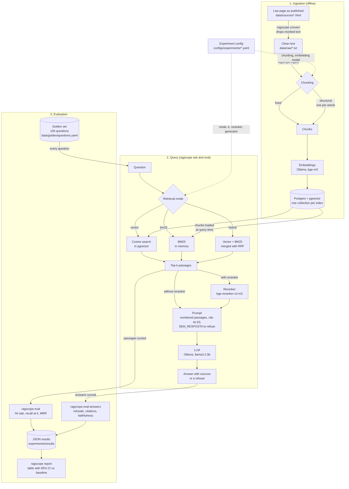

# RAGscope

> A Go laboratory that runs many RAG configurations over the same corpus and tells you, **with numbers**, which one is best on quality, cost and latency.

**Status:** working end to end on one corpus (the Brazilian data protection law, LGPD). Seven retrieval configurations are compared with confidence intervals, a reranker is included, and answers are generated and scored. Still missing: a correctness metric for answers, comparison with hosted models, query rewriting and a demo. See the [roadmap](#roadmap).

---

## Why this project exists

Most RAG demos are "chat with a PDF": one fixed pipeline, no evidence that it works, no way to know whether a change made it better or worse.

RAGscope inverts that. **The product is the benchmark, not the chatbot.** The `ask` command is just a demo surface; the value is a reproducible experiment runner that answers questions like:

- Does structure-aware chunking beat fixed-size chunking on legal text?
- How much recall does hybrid search (vector + BM25) buy?
- Is a reranker worth its extra time?
- Can a small local model answer well, and does it know when to refuse?

## Corpus

The **LGPD** (Lei nº 13.709/2018), from the official Planalto portal. Public text, in Portuguese, organized in articles, paragraphs and items. The pipeline is domain-agnostic: another corpus needs a new source and a new golden set.

The page marks revoked wording with a strike, which a plain copy and paste loses. So the original page is kept in `data/sources/` and `ragscope convert` rebuilds the clean text from it. Details in [data/README.md](data/README.md).

## Architecture

The full explanation is in [docs/architecture.md](docs/architecture.md).



## Results

Retrieval, on the 95 questions that the law answers. Each experiment changes **one thing** from the baseline (fixed chunks of 512 words, vector search, top 5). Δ is the difference to the baseline with a 95% confidence interval; **\*** means the interval does not include zero.

| Experiment | What changes | Recall@1 | Δ Recall@1 | Recall@5 | MRR@5 |
|---|---|--:|--:|--:|--:|
| `hybrid-rerank-structural` | one chunk per article, vector + BM25, reranker | **0.695** | **+0.144 [+0.027, +0.258] \*** | 0.886 | **0.806** |
| `ablation-rerank` | reranker over 10 candidates | 0.677 | **+0.126 [+0.035, +0.219] \*** | 0.886 | 0.795 |
| `ablation-structural` | one chunk per article | 0.611 | +0.059 [−0.047, +0.168] | 0.881 | 0.746 |
| `ablation-hybrid` | vector + BM25 merged with RRF | 0.572 | +0.021 [−0.074, +0.112] | **0.895** | 0.738 |
| `baseline` | — | 0.551 | — | 0.870 | 0.712 |
| `ablation-hybrid-structural` | one chunk per article and vector + BM25 | 0.547 | −0.004 [−0.123, +0.115] | 0.812 | 0.665 |
| `ablation-bm25` | BM25 only | 0.486 | −0.065 [−0.179, +0.047] | 0.818 | 0.644 |

Reproduce the tables with `ragscope report --k 1` and `ragscope report`.

### What the numbers say

- **The reranker is the only change that clearly helps**, and only at the top of the list: the relevant passage comes first much more often (recall@1 from 0.551 to 0.677 and 0.695). Its recall@5 is about the same as the baseline, because it reorders candidates instead of finding new ones. That matters for small models, which depend on the first passage.
- **Everything else is inside the noise.** With 95 questions, the intervals of structural chunking, hybrid search and BM25 all include zero.
- **An early conclusion did not survive.** With the first 30 questions, structural chunking looked like a big win (+0.200 recall@5). With 64 it was +0.039, and with 95 it was +0.011. The first questions were written close to the wording of the articles, which favours that kind of chunking. A small, hand-shaped test set can mislead.
- **Combining two things that help did not add up.** Structural chunks plus hybrid search without a reranker were *worse* than either alone. The reason is not known yet.

### Answers (first sample only)

20 questions, `ablation-structural` with `llama3.2:3b` (18 answerable, 2 unanswerable). Too small to quote as a result, but it showed what to look at:

- It refused 5 of 18 answerable questions. In 3 of them the right passage was **not** in the retrieved set, so refusing was correct behaviour. In 2 the passage was first and the model refused anyway.
- 69% of the real answers cited a passage.
- One answer defined the wrong concept (it described "pseudonimização" when asked about "anonimização") while citing a passage that really says that. It is faithful to the passage but wrong, which faithfulness does not catch.
- About 16 s per answer on an 8 GB laptop.

## Quick start

You need Go 1.27, Docker, [Ollama](https://ollama.com) and (only for the reranker) Python 3.

```bash
make build
make up                # Postgres with pgvector
make models            # pulls bge-m3 (embeddings) and llama3.2:3b (answers)

./bin/ragscope ingest -c configs/experiments/baseline.yaml
./bin/ragscope ask    -c configs/experiments/baseline.yaml "Quanto tempo a empresa tem para me entregar os meus dados?"
./bin/ragscope eval   -c configs/experiments/baseline.yaml
./bin/ragscope report
```

For the experiments that use a reranker, set up Python once and run the server in another terminal:

```bash
python3 -m venv .venv && .venv/bin/pip install -r scripts/requirements.txt
make rerank            # downloads the model (about 2 GB) the first time
```

All commands:

| Command | What it does |
|---|---|
| `convert <page.html> <out.txt>` | turns a saved law page into clean text, dropping revoked wording |
| `golden` | checks the golden set and that every evidence snippet exists in the corpus |
| `ingest -c <config>` | chunks, embeds and stores the corpus |
| `ask -c <config> "<question>"` | answers a question and lists the sources (`--chunks-only` skips the model) |
| `eval -c <config>` | scores retrieval against the golden set |
| `eval-answers -c <config>` | generates answers and scores refusals and citations (`--limit N`, `--judge`) |
| `report [--k N]` | compares saved results, with confidence intervals |
| `validate <config>...` | checks experiment config files |
| `serve` | HTTP server (health check only for now) |

The full recipe to reproduce the table above is in [docs/methodology.md](docs/methodology.md).

## Experiments

Every pipeline variable is an axis. Experiments are **YAML files**, so each result can be reproduced from a config and a commit.

| Axis | Implemented | Not yet |
|---|---|---|
| Chunking | fixed, structural (one chunk per article) | recursive, semantic |
| Embedding model | any model served by Ollama (`bge-m3` used) | hosted models |
| Retrieval | vector, BM25, hybrid (RRF) | |
| Reranking | cross-encoder `bge-reranker-v2-m3` | hosted reranker |
| Top-k | any | |
| Generator | Ollama (`llama3.2:3b` used) | Anthropic, OpenAI |
| Query rewriting | | HyDE, multi-query |

The full product of all axes is too large, so RAGscope uses **ablation**: a documented baseline and **one change at a time**. `ablation-hybrid-structural` and `hybrid-rerank-structural` are the targeted combinations.

```yaml
name: hybrid-rerank-structural
corpus: br-legislation-v1
chunking:
  strategy: structural
  max_tokens: 512
  overlap: 64
embedding:
  model: bge-m3
retrieval:
  mode: hybrid
  k: 10
  fusion: rrf
reranker:
  model: bge-reranker-v2-m3
  top_n: 5
generator:
  provider: ollama
  model: llama3.2:3b
  temperature: 0
```

## Evaluation

The full description is in [docs/methodology.md](docs/methodology.md). In short:

- **Golden set:** 105 questions (95 answerable, 10 not), each with literal snippets of the law as evidence. A chunk is relevant if it contains a snippet, so the same set works for every chunking strategy.
- **Written by a model, reviewed by other agents.** The questions were drafted by an AI model and two batches were reviewed by independent agents that read the law first. They found problems in about a third of the questions, which were fixed. A person's review of a sample is still missing.
- **Retrieval metrics** (no model involved): hit rate, recall@k and MRR.
- **Answer metrics:** correct and false refusal, citation rate and an optional faithfulness judge. The judge is a small model, so its score is **not calibrated**.
- **Statistics:** a paired bootstrap against the baseline, question by question.

## Tech stack

| Concern | Choice |
|---|---|
| Language | Go 1.27 |
| CLI | `cobra` |
| HTTP | stdlib `net/http` (health check only for now) |
| Storage | PostgreSQL + `pgvector` through `pgx`, exact search with no ANN index |
| Lexical search | BM25 implemented in Go, in memory ([ADR 0001](docs/adr/0001-bm25-implementation.md)) |
| Embeddings and answers | Ollama on the host (uses the Mac GPU) |
| Reranker | `bge-reranker-v2-m3`. TEI in Docker on x86; `scripts/rerank_server.py` serves the same API on Apple Silicon |
| Orchestration | hand-written, thin pipeline, **no LangChain-style framework**, so every stage is explicit and measurable |
| Evaluation | metrics, bootstrap and judge written in Go |
| Tooling | `go test`, `govulncheck`, Docker Compose, GitHub Actions |

### Design principles

- **Every stage is an interface** (`Chunker`, `Embedder`, `Retriever`, `Reranker`, `Generator`), so an experiment is just a different wiring of implementations.
- **Reproducibility first:** the golden set carries a fingerprint, saved with every result.
- **Fail loudly on unanswerable questions:** refusing correctly is a first-class metric.
- **Honest numbers:** every comparison shows whether the difference is bigger than luck.

## Repository layout

```
RAGscope/
├── cmd/ragscope/          # CLI
├── internal/
│   ├── ingest/            # HTML to text, chunkers
│   ├── embed/             # Ollama embeddings
│   ├── retrieve/          # vector, BM25, hybrid, reranked
│   ├── rerank/            # reranker client
│   ├── generate/          # prompt and Ollama generator
│   ├── eval/              # golden set, metrics, judge
│   ├── report/            # comparison table and bootstrap
│   ├── store/             # Postgres and pgvector
│   ├── config/            # experiment config
│   ├── httpjson/          # small JSON over HTTP client
│   ├── pipeline/          # ingestion flow
│   ├── domain/            # shared types
│   └── api/               # HTTP handlers
├── configs/experiments/   # one YAML per experiment
├── data/
│   ├── sources/           # original law page
│   ├── raw/               # clean text read by ingest
│   └── golden/            # the golden set
├── docs/                  # architecture, methodology, ADRs
├── scripts/               # local reranker server
├── deployments/           # docker-compose.yml
└── .github/workflows/
```

## Roadmap

- [x] **Foundation:** Go module, CLI, Docker Compose, Ollama, CI (format, vet, tests, config validation, `govulncheck`)
- [x] **Baseline:** ingest, fixed chunks, vector search, `ask` with sources
- [x] **Evaluation first:** golden set (105 questions), retrieval metrics, `report` with confidence intervals
- [x] **Ablations on retrieval:** structural chunking, BM25, hybrid, reranker
- [ ] **Ablations on answers**
  - [x] generator, citations and refusal, first sample
  - [ ] split false refusals by cause (retrieval or model)
  - [ ] full run of the golden set
  - [ ] correctness against the reference answer
  - [ ] judge calibrated with human grades
  - [ ] query rewriting (HyDE, multi-query)
  - [ ] comparison with a hosted model, with cost
- [ ] **Polish:** `/ask` endpoint and a small interface, demo, lint and a regression gate in CI, license

## Known limitations

- **One corpus, one language.** Conclusions may not carry over to other laws or domains.
- **The golden set was written by a model.** Reviewed by other agents, not yet by a person.
- **95 questions** cannot tell small differences apart, and the intervals assume independent questions when several come from the same article.
- **Latency is not reliable.** It was measured on an 8 GB laptop with the swap nearly full. Treat the reranker's times as an upper bound.
- **The answer judge is weak and uncalibrated.**
- **Answers are only measured on a 20-question sample so far.**

## License

To be defined.
