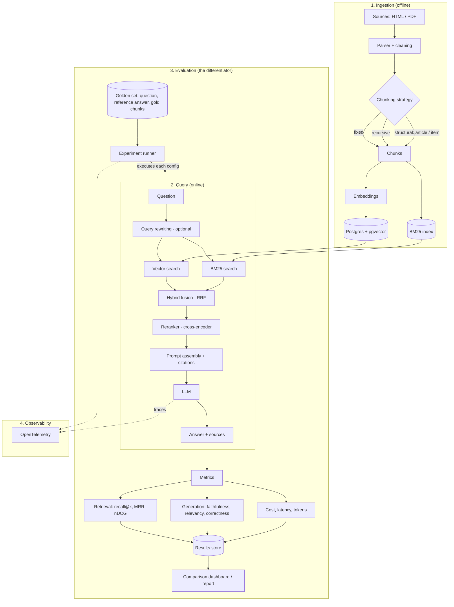

# RAGscope

> A Go laboratory that runs many RAG configurations over the same corpus and tells you, **with numbers**, which one is best on quality, cost and latency.

**Status:** 🚧 Planning — nothing is implemented yet. This README is the project plan and will be replaced by real results as the phases below are completed.

---

## Why this project exists

Most RAG demos are "chat with a PDF": one fixed pipeline, no evidence that it works, no way to know whether a change made it better or worse.

RAGscope inverts that. **The product is the benchmark, not the chatbot.** The chat endpoint is just a demo surface; the value is a reproducible experiment runner that answers questions like:

- Does structure-aware chunking beat fixed-size chunking on legal text?
- How much recall does hybrid search (vector + BM25) buy, and at what latency cost?
- Is a reranker worth its extra milliseconds and dollars?
- Can a small local model match a large hosted one once retrieval is good?

## Domain and corpus

**Brazilian legislation** (e.g. CLT, LGPD, Marco Civil da Internet, Código de Defesa do Consumidor), sourced from official public portals.

Why this domain:

- Public-domain text, in Portuguese — a less saturated space than English docs.
- Naturally structured (articles, paragraphs, items), which makes chunking a meaningful experiment.
- Questions can have verifiable, citable answers.
- Includes cross-references between articles, which stress-tests multi-chunk retrieval.

The pipeline itself is domain-agnostic: swapping the corpus should only require a new ingestion config and a new golden set.

## Architecture



## Experiment strategy

Every pipeline variable is an axis. Experiments are declared as **YAML files** so every result is reproducible from a config and a commit hash.

| Axis | Variations |
|---|---|
| Chunking | fixed size (256 / 512 / 1024 tokens), recursive, structural (by article), semantic |
| Embedding model | `bge-m3`, `multilingual-e5`, one hosted model |
| Retrieval | vector only, BM25 only, hybrid (RRF) |
| Reranking | none, open-source cross-encoder, hosted reranker |
| Top-k | 3, 5, 10 |
| Query rewriting | off, HyDE, multi-query |
| Generator LLM | large hosted, small hosted, local (Ollama) |

The full Cartesian product is too large (and too expensive), so RAGscope uses **ablation studies**: start from a documented baseline and change **one axis at a time**. Interactions between the winning settings are tested afterward in a small, targeted grid.

Example experiment config:

```yaml
name: hybrid-rerank-structural
corpus: br-legislation-v1
chunking:
  strategy: structural
  max_tokens: 512
embedding:
  model: bge-m3
retrieval:
  mode: hybrid
  k: 10
  fusion: rrf
reranker:
  model: bge-reranker-v2-m3
  top_n: 5
generator:
  model: <provider/model>
  temperature: 0
```

## Evaluation methodology

### Golden set

- **100–200 questions**, each with a reference answer and the gold source chunk(s).
- Drafted with an LLM from the corpus, then **manually reviewed** (a documented sample at minimum).
- Covers several question types: single-fact, multi-chunk, comparative, and **unanswerable** (the answer is not in the corpus — the system must refuse rather than hallucinate).
- Versioned in the repository, with a description of how it was built and its known biases.

### Metrics

| Layer | Metrics | Needs an LLM? |
|---|---|---|
| Retrieval | recall@k, hit rate, MRR, nDCG | No (cheap, deterministic) |
| Generation | faithfulness (grounded in context), answer relevancy, correctness vs. reference | Yes (LLM-as-judge) |
| System | latency p50 / p95, cost per query, tokens in / out | No |
| Robustness | correct-refusal rate on unanswerable questions | Partly |

### Trusting the judge

LLM-as-judge scores are only credible if calibrated. A subset of answers is graded by a human and the **judge–human agreement is reported** alongside results. Judge outputs are cached to keep re-runs cheap and deterministic.

### Regression gate

A small evaluation subset runs in CI. A pull request that drops a headline metric beyond a set threshold fails the check.

## Tech stack (Go 1.27)

| Concern | Choice |
|---|---|
| Language | Go 1.27 |
| CLI | `cobra` (`ragscope ingest`, `ragscope eval`, `ragscope serve`, `ragscope report`) |
| HTTP API | stdlib `net/http` with the enhanced `ServeMux` routing |
| Storage | PostgreSQL + `pgvector` via `pgx` |
| Lexical search | BM25 (in-process Go implementation, or Postgres-side extension — to be decided in an ADR) |
| Embeddings | Ollama (`bge-m3`), running on the host so it can use Apple Silicon, behind a Go interface |
| Reranker | Cross-encoder `bge-reranker-v2-m3` behind a Go interface. Hugging Face TEI in Docker on x86; on Apple Silicon `scripts/rerank_server.py` serves the same API |
| LLM providers | Provider interface with adapters: Anthropic, OpenAI-compatible, Ollama |
| Orchestration | Hand-written, thin pipeline — **no LangChain-style framework in the core**, so every stage is explicit and measurable |
| Evaluation | Metrics and LLM-judge implemented in Go (existing eval tooling is Python-centric) |
| Concurrency | Worker pools with `errgroup` for parallel experiment runs, with rate limiting per provider |
| Observability | `log/slog` + OpenTelemetry traces |
| Reports | Static HTML/Markdown report generated from the results store |
| Tooling | `golangci-lint`, `go test` with table-driven tests, `govulncheck`, Docker Compose, GitHub Actions |

### Design principles

- **Every stage is an interface** (`Chunker`, `Embedder`, `Retriever`, `Reranker`, `Generator`, `Metric`), so an experiment is just a different wiring of implementations.
- **Reproducibility first**: pinned corpus version, seeded sampling, config + commit hash stored with every result.
- **Cost awareness**: token and latency accounting is built into the core, not bolted on.
- **Fail loudly on unanswerable questions**: refusing correctly is a first-class metric.

## Planned repository layout

```
RAGscope/
├── cmd/ragscope/          # CLI entrypoint
├── internal/
│   ├── ingest/            # parsers and chunkers
│   ├── embed/             # embedding clients
│   ├── retrieve/          # vector, BM25, hybrid fusion
│   ├── rerank/            # reranker clients
│   ├── generate/          # LLM provider adapters, prompts
│   ├── pipeline/          # wiring of stages from a config
│   ├── eval/              # metrics, judge, experiment runner
│   ├── store/             # Postgres / pgvector access, results store
│   ├── api/               # HTTP handlers
│   └── report/            # report generation
├── configs/experiments/   # YAML experiment definitions
├── data/
│   ├── raw/               # source documents (or download scripts)
│   └── golden/            # versioned golden set
├── docs/
│   ├── adr/               # architecture decision records
│   └── methodology.md
├── deployments/           # docker-compose.yml
└── .github/workflows/
```

## Roadmap

- [ ] **Phase 0 — Foundation:** Go module, CLI skeleton, Docker Compose (Postgres + pgvector), Ollama for embeddings, CI (lint, test, vuln check).
- [ ] **Phase 1 — Baseline:** ingest one or two laws, fixed-size chunking, vector search, answers with citations, minimal API.
- [ ] **Phase 2 — Evaluation first:** 50-question golden set, retrieval + generation metrics, experiment runner, first baseline report. **No optimization happens before this exists.**
- [ ] **Phase 3 — Ablations:** structural chunking, hybrid search, reranking, query rewriting, model comparisons — each documented with results and trade-offs.
- [ ] **Phase 4 — Polish:** full golden set, judge calibration, CI regression gate, dashboard/report, hosted demo, write-up.

## Success criteria

The project is "done" when the README leads with a results table such as:

> *Structural chunking + hybrid retrieval + reranking raised recall@5 from X to Y over the baseline, at +Z ms p95 latency and +$W per 1k queries.*

…and anyone can reproduce it with a handful of commands:

```bash
docker compose up -d
ragscope ingest --config configs/experiments/baseline.yaml
ragscope eval   --config configs/experiments/baseline.yaml
ragscope report
```

## Known risks

- **Optimizing without a golden set** — mitigated by making Phase 2 a hard prerequisite for Phase 3.
- **Uncalibrated LLM judge** — mitigated by human-graded subset and reported agreement.
- **Evaluation cost** — mitigated by response/judge caching and running ablations with cheaper models.
- **Golden-set bias** (LLM-generated questions favor the generator's phrasing) — documented, partially mitigated by manual review and hand-written questions.
- **Source licensing** — restricted to official public-domain legislation.

## License

To be defined.
