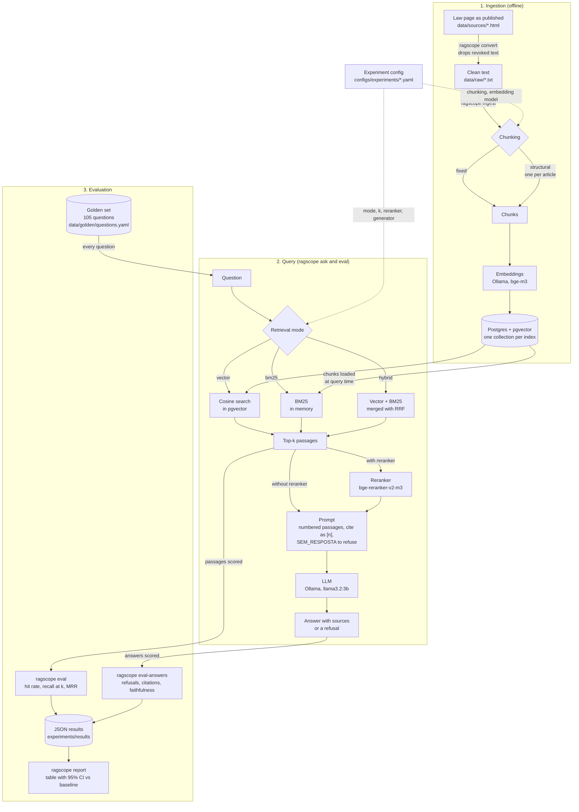

# Architecture

This is how RAGscope works today, from the law text to the comparison table.
The same diagram is in the [README](../README.md). If you change one, change both.

## What each stage does

| Stage | What it does | Code |
|---|---|---|
| `convert` | Reads the saved law page and keeps only the current wording. The page shows revoked text struck through, and a plain copy and paste would mix old and new versions. | `internal/ingest/html.go` |
| `ingest` | Cuts the text into chunks, embeds them and stores them. Experiments that only differ in retrieval, reranking or generation share one index. | `internal/ingest`, `internal/embed`, `internal/store` |
| Retrieval | Finds the chunks closest to the question: by meaning (vector), by words (BM25) or both merged with Reciprocal Rank Fusion. | `internal/retrieve` |
| Reranker | A cross-encoder re-scores the candidates and keeps the best ones. It is the only stage that reads the question and the passage together. | `internal/rerank`, `scripts/rerank_server.py` |
| Generation | Builds a prompt with numbered passages and asks the model to answer only from them, to cite them, and to say `SEM_RESPOSTA` when they do not contain the answer. | `internal/generate` |
| `eval` | Checks, for each golden question, where the evidence snippet shows up in the retrieved passages. No model is involved, so it is cheap and repeatable. | `internal/eval` |
| `eval-answers` | Generates the answers and scores refusals, citations and (optionally) faithfulness judged by a model. | `internal/eval` |
| `report` | Compares the saved results and says whether a difference is bigger than luck. | `internal/report` |

## Decisions worth knowing

- **Every stage is an interface** (`Chunker`, `Embedder`, `Retriever`, `Reranker`, `Generator`), so an experiment is only a different wiring of the same pieces.
- **A collection is named after what changes the index** (corpus, chunking, embedding model), not after the experiment. That is why `baseline`, `ablation-bm25` and `ablation-hybrid` need a single `ingest`.
- **The golden set points to text, not to chunks.** Each question carries a literal snippet of the law, and a chunk counts as relevant if it contains it. Chunk ids change with every chunking strategy, snippets do not.
- **Vector search is exact**, with no ANN index. For a few thousand chunks it is fast, and it keeps the recall numbers free of index approximation.
- **BM25 lives in memory**, built from the stored chunks. See [ADR 0001](adr/0001-bm25-implementation.md).
- **Embeddings and answers run on Ollama**, on the host, so they can use the Mac GPU. The reranker is a small local Python server on Apple Silicon, because the TEI image only exists for x86.
