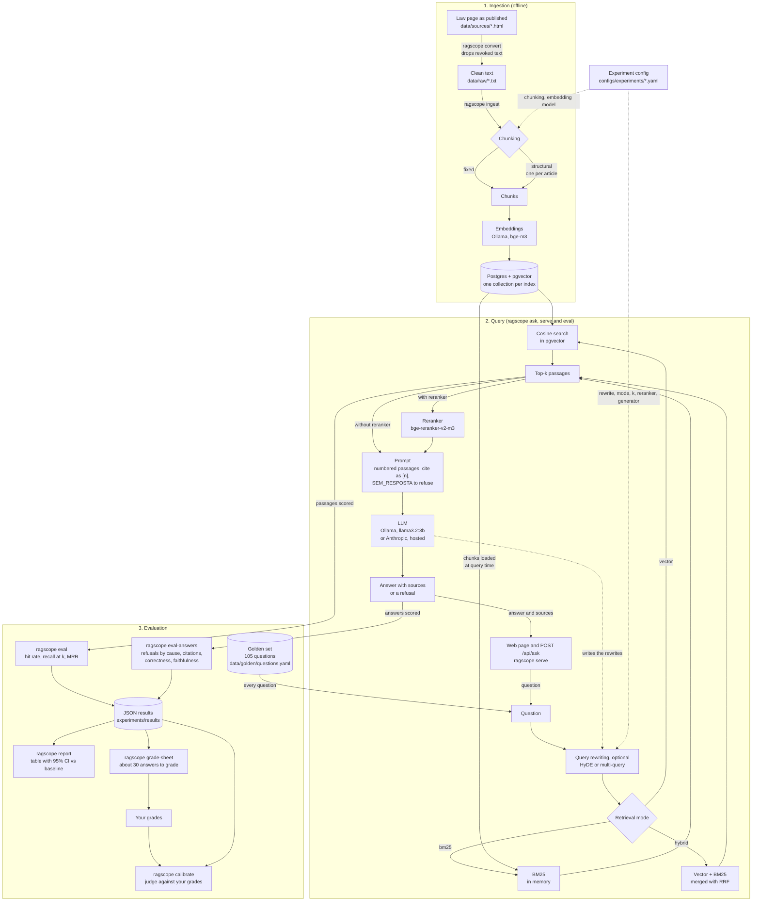

# Architecture

This is how RAGscope works today, from the law text to the comparison table.
The same diagram is in the [README](../README.md). If you change one, change both.

## What each stage does

| Stage | What it does | Code |
|---|---|---|
| `convert` | Reads the saved law page and keeps only the current wording. The page shows revoked text struck through, and a plain copy and paste would mix old and new versions. | `internal/ingest/html.go` |
| `ingest` | Cuts the text into chunks, embeds them and stores them. Experiments that only differ in retrieval, rewriting, reranking or generation share one index. | `internal/ingest`, `internal/embed`, `internal/store` |
| Query rewriting | Optional. **HyDE** asks the model for a short hypothetical passage and searches with the question plus that passage. **Multi-query** asks for several rephrasings, searches each one and merges the rankings with RRF. The experiment's own model does the rewriting. | `internal/retrieve/rewrite.go` |
| Retrieval | Finds the chunks closest to the question: by meaning (vector), by words (BM25) or both merged with Reciprocal Rank Fusion. | `internal/retrieve` |
| Reranker | A cross-encoder re-scores the candidates and keeps the best ones. It is the only stage that reads the question and the passage together. | `internal/rerank`, `scripts/rerank_server.py` |
| Generation | Builds a prompt with numbered passages and asks the model to answer only from them, to cite them, and to say `SEM_RESPOSTA` when they do not contain the answer. The model is local (Ollama) or hosted (Anthropic, with cost counted per call). | `internal/generate` |
| `serve` | A small HTTP server with `POST /api/ask` and a one-page web interface. It has no authentication, so it is for local use only. | `internal/api`, `internal/pipeline` |
| `eval` | Checks, for each golden question, where the evidence snippet shows up in the retrieved passages. No model is involved, so it is cheap and repeatable. | `internal/eval` |
| `eval-answers` | Generates the answers and scores refusals (split by cause), citations, cost and, optionally, correctness against the reference answer and faithfulness to the passages, both judged by a model. | `internal/eval` |
| `grade-sheet`, `calibrate` | The judge is a model, so it must be checked against a person. `grade-sheet` writes about 30 answers for you to grade, without showing the judge's verdicts. `calibrate` compares your grades with the judge's. | `internal/eval/calibration.go` |
| `report` | Compares the saved results and says whether a difference is bigger than luck. | `internal/report` |

## Decisions worth knowing

- **Every stage is an interface** (`Chunker`, `Embedder`, `Retriever`, `Reranker`, `Generator`), so an experiment is only a different wiring of the same pieces. Query rewriting and reranking are decorators over any retriever.
- **A collection is named after what changes the index** (corpus, chunking, embedding model), not after the experiment. That is why `baseline`, `ablation-bm25`, `ablation-hyde` and `ablation-hybrid` need a single `ingest`.
- **The golden set points to text, not to chunks.** Each question carries a literal snippet of the law, and a chunk counts as relevant if it contains it. Chunk ids change with every chunking strategy, snippets do not.
- **A refusal is split by cause.** If the evidence was not among the passages, refusing was fair and the retriever is to blame. If it was there and the model refused anyway, the model was too timid. Counting both as "false refusal" hid this.
- **Hosted models cannot report a zero cost by accident.** The config requires the prices per million tokens for a hosted provider, and the API key only comes from the environment.
- **Vector search is exact**, with no ANN index. For a few thousand chunks it is fast, and it keeps the recall numbers free of index approximation.
- **BM25 lives in memory**, built from the stored chunks. See [ADR 0001](adr/0001-bm25-implementation.md).
- **Embeddings and answers run on Ollama**, on the host, so they can use the Mac GPU. The reranker is a small local Python server on Apple Silicon, because the TEI image only exists for x86.
- **CI protects the parts that need no model.** A regression test chunks the real corpus, searches it with BM25 and fails if recall drops, which guards the chunkers, the tokenizer, BM25, the metric code and the golden set. It does not measure embeddings or models.
